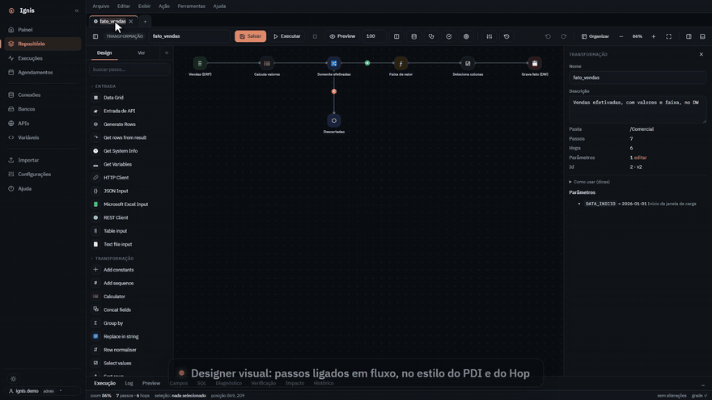
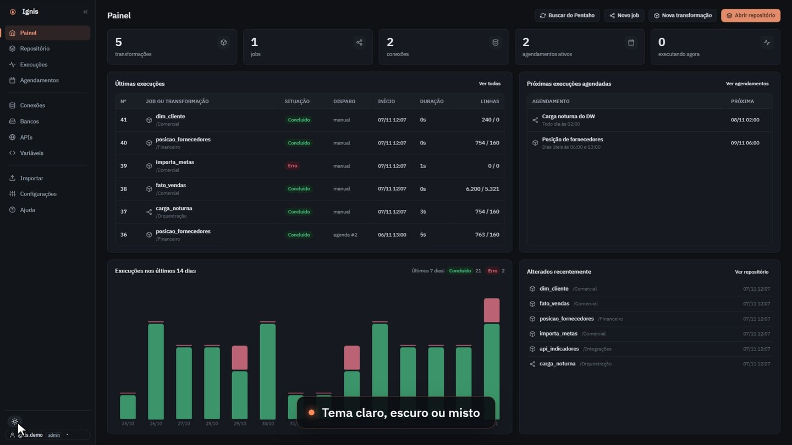
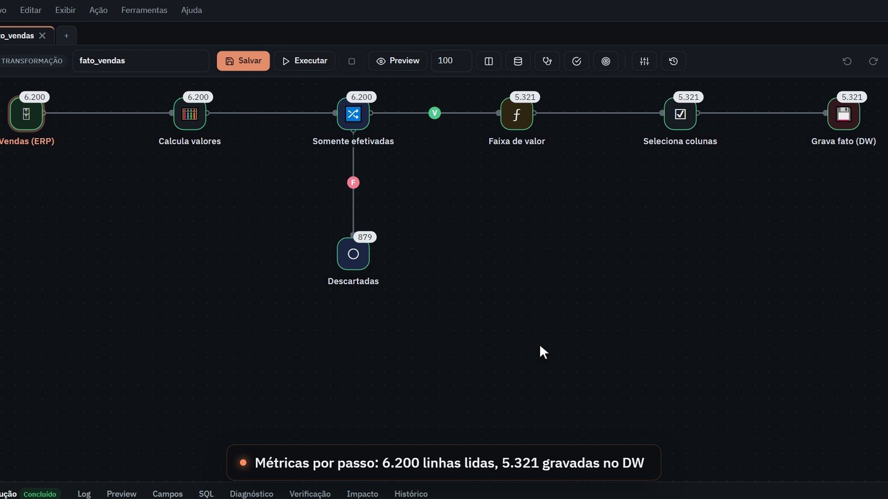
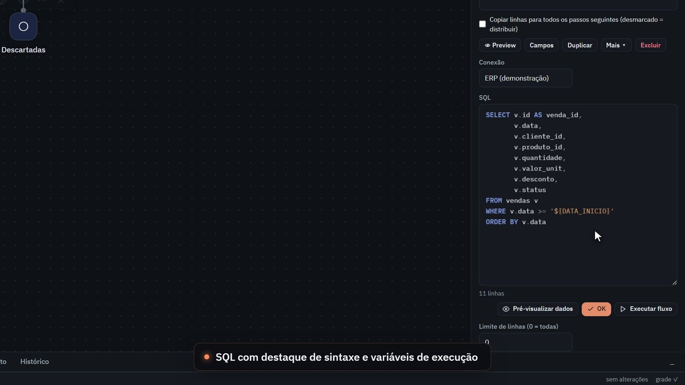
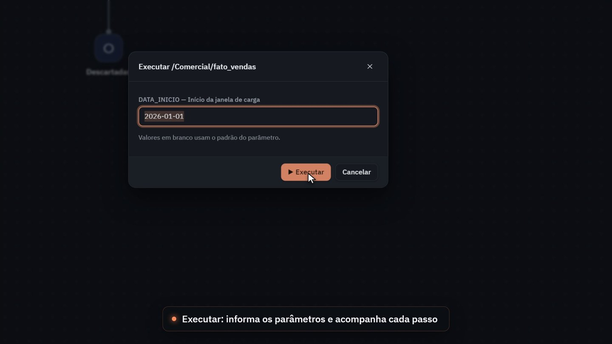
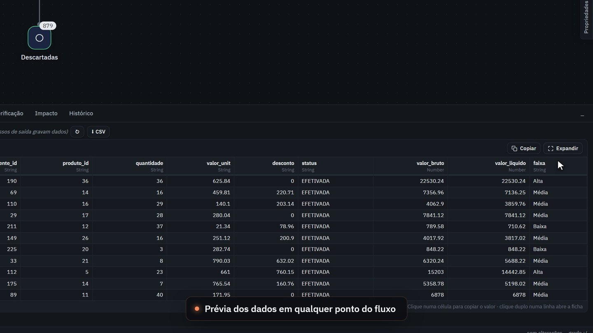
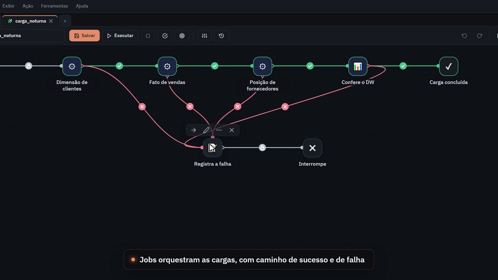
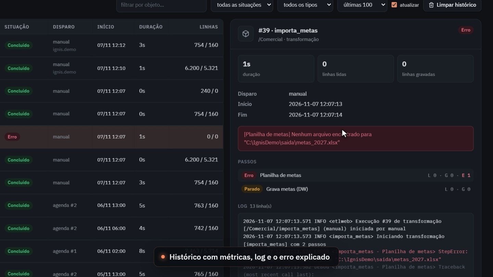
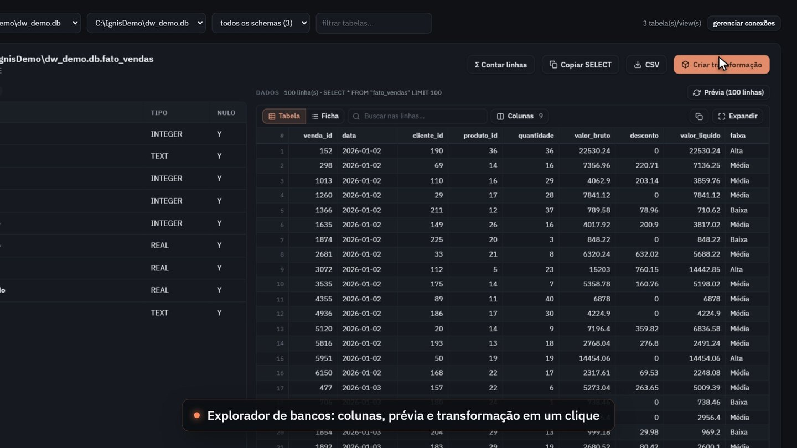
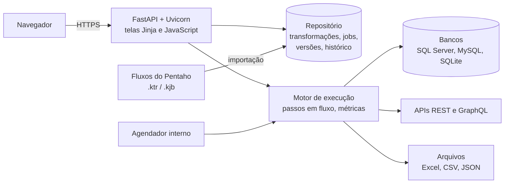

<h1 align="center">Ignis</h1>

  <b>Plataforma de ETL na web: desenhe, execute, agende e acompanhe integrações de dados direto no navegador.</b> 
  Nasceu do dia a dia com o Pentaho PDI, se inspirou no Apache Hop e quer ir além dos dois.

  
  
  
  
  

---

## Por que existe

O Pentaho Data Integration sempre esteve no centro das cargas de dados, e o Apache Hop mostrou como esse modelo pode
evoluir. O Ignis mantém o que os dois fazem muito bem, que é **desenhar transformações e jobs visualmente, passo a
passo**, e resolve o que fazia falta no dia a dia:

- abrir pelo navegador, sem instalar nada na máquina de quem usa;
- ver **o que rodou, o que falhou e por quê** sem caçar log em servidor;
- agendar sem depender de script solto no Agendador do Windows;
- segurança desde o primeiro dia: usuário da rede, papéis e conexões somente leitura por padrão;
- migrar aos poucos: o Ignis **lê os fluxos do Pentaho** (`.ktr` e `.kjb`) e roda lado a lado.

## O que já faz

| | |
|---|---|
| **Designer visual** | transformações e jobs no navegador, com mais de 50 tipos de passo (entrada de tabela, calculadora, filtro, fórmula, junções, busca em banco, dimensões, REST e GraphQL, Excel, JSON, script Python...) |
| **Execução com métricas** | linhas lidas, gravadas, rejeitadas e tempo em cada passo, em tempo real |
| **Prévia** | os dados de qualquer ponto do fluxo, sem gravar nada |
| **SQL** | editor com destaque de sintaxe e variáveis de execução (`${DATA_INICIO}`) |
| **Jobs** | orquestração com caminho de sucesso e de falha |
| **Histórico** | cada execução com métricas, log e o **erro explicado em linguagem clara** |
| **Agendamentos** | integrados, descritos em linguagem simples ("todo dia às 02:00") |
| **Explorador de bancos** | tabelas, colunas, prévia e "criar transformação" em um clique |
| **Repositório** | pastas, busca e histórico de versões de cada objeto |
| **Importação do Pentaho** | lê `.ktr` e `.kjb` e converte os passos conhecidos |

## Telas

<table>
  <tr>
    <td width="50%"> <b>Painel</b> · o que rodou, o que falhou e o que vem a seguir</td>
    <td width="50%"> <b>Designer</b> · métricas em cada passo: 6.200 linhas lidas, 5.321 gravadas</td>
  </tr>
  <tr>
    <td> <b>SQL</b> · destaque de sintaxe e variáveis de execução</td>
    <td> <b>Execução</b> · parâmetros informados na hora</td>
  </tr>
  <tr>
    <td> <b>Prévia</b> · dados de qualquer ponto do fluxo</td>
    <td> <b>Jobs</b> · caminho de sucesso e de falha</td>
  </tr>
  <tr>
    <td> <b>Histórico</b> · métricas, log e o erro explicado</td>
    <td> <b>Explorador de bancos</b> · colunas, prévia e transformação em um clique</td>
  </tr>
</table>

## Arquitetura

## Segurança

- entrada com o **usuário da rede** (LDAPS) e permissões por papel;
- **somente HTTPS** e acesso restrito à rede interna;
- conexões novas nascem **somente leitura**; gravar exige liberação explícita;
- senhas de conexão **cifradas** no repositório e nunca exibidas na tela;
- cada execução registra quem disparou, quando e o que aconteceu.

## Próximos passos

Hoje o Ignis roda **na web**. O próximo passo é a versão **aplicativo**, usando o **mesmo repositório**, para quem
prefere trabalhar no desktop sem abrir mão da web.

## Sobre o código

O Ignis está em produção interna, com dados reais, e por isso **o código-fonte não é público**. Tudo o que aparece
nesta página foi gravado numa cópia isolada, com bancos e cadastros **fictícios**.

As técnicas que ele usa aparecem em projetos abertos deste perfil:
[espelho incremental para o DW](https://github.com/EdyVerder/dw-tempo-real),
[conferência por regras](https://github.com/EdyVerder/conferencia-nfse) e
[relatórios automáticos](https://github.com/EdyVerder/relatorios-automaticos).

---

Feito por <a href="https://github.com/EdyVerder">Rocha</a> · demonstração com dados fictícios

